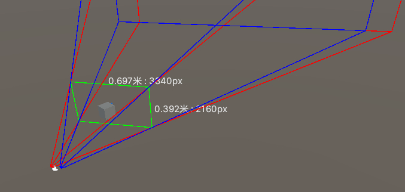
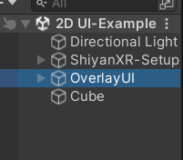
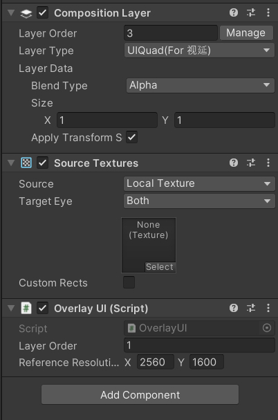
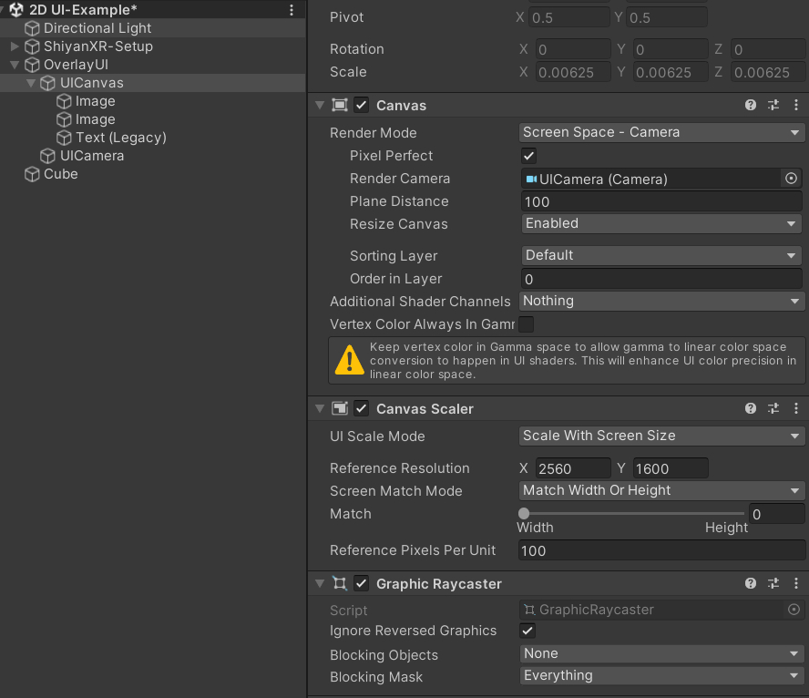
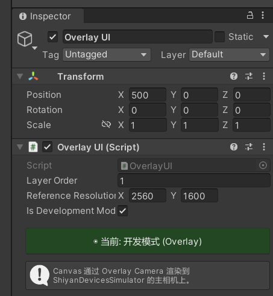

现在UI方式支持2中方式：
- 0视差面 WorldSpace canvas。
- ScreenSpace Canvas 或则 WorldSpace Canvas

## 0视差面 WorldSpace canvas -3D UI

在场景里的0视差面（使用 **ShiyanXR-Setup**）可以在scene view模拟出离轴的左右相机，2个相机4条侧边相交得到的屏幕即为**0视差面**。 
可以在这里创建一个世界空间的canvas，调整大小和0视差面大小一样即可。(**ShiyanXR-Setup** 有相应的菜单来创建，不用手动调大小)

***原理：使用左右相机分别渲染得到左右视图，但没有视差。这个方式由于使用的是3D投影相机来渲染的，UI像素不能 像素对齐，所以人头晃动的时候UI会有轻微闪烁，毛边等现象***

## 2D UI

开发方式和传统的Unity UI开发基本保持一致。 

#### 1. 创建一个空物体,改名OverlayUI（按自己的喜好改即可）；

#### 2. 往刚创建的空物体挂载 OverlayUI 组件。此时会自动添加 Composition Layer 和 Source Texture；

#### 3. 设置属性
|属性|说明|
|----|----|
|Layer Order|有多个Overlay UI的时候，值越大越上层|
|Reference Resolution|设备单目分辨率，这个值会在运行时自动设置canvas的Reference Resolution|

OverlayUI 组件inspector有一个按钮 **开发者模式/产品模式**。
- 开发者模式：用于开发
- 产品模式：用于构建时
 

***原理：***
canvas的render camera会把canvas的UI渲染到一张根据Reference Resolution大小创建的Render Texture，然后通过openxr 的composition layer送到openxr runtime。  runtime侧在XREndFrame的时候能拿到这个图层，然后在和3D场景进行基于alpha叠加。

***Note:视延runtime针对quad 类型的layer固定看成时UI层，且叠在3D场景上面。runtime侧SBS逻辑时固定那左眼图像当成左右眼，不会进行3D投影，直接把quad当成裁剪空间进行满屏渲染***